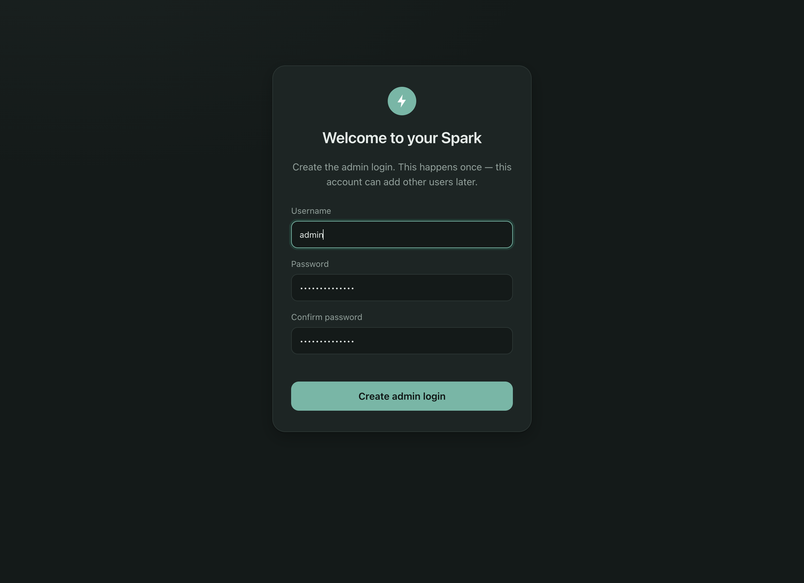
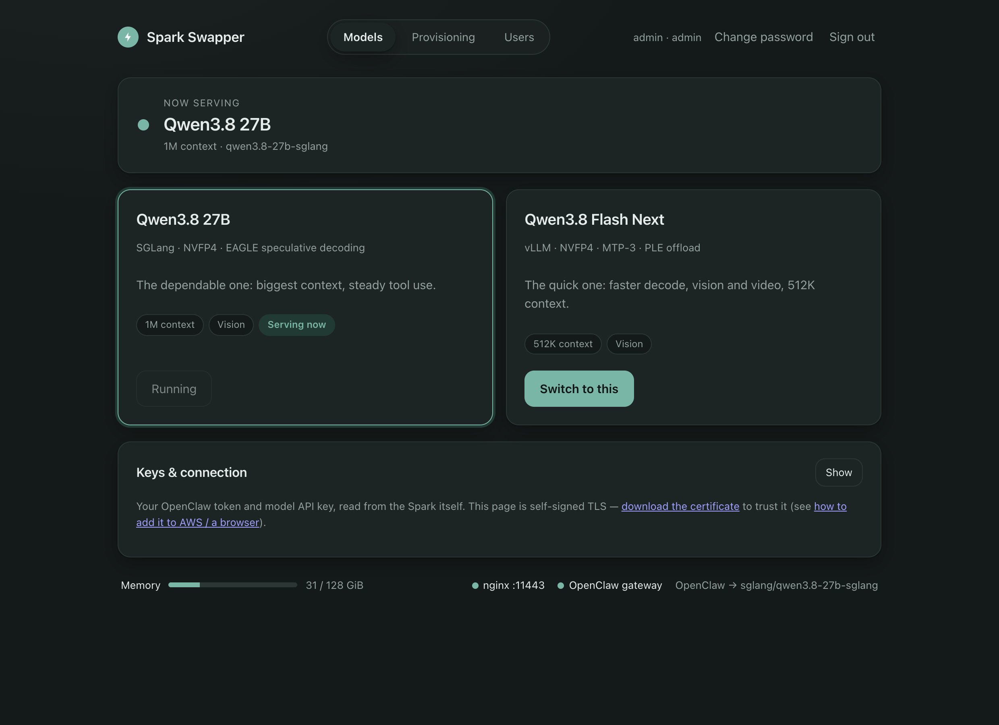
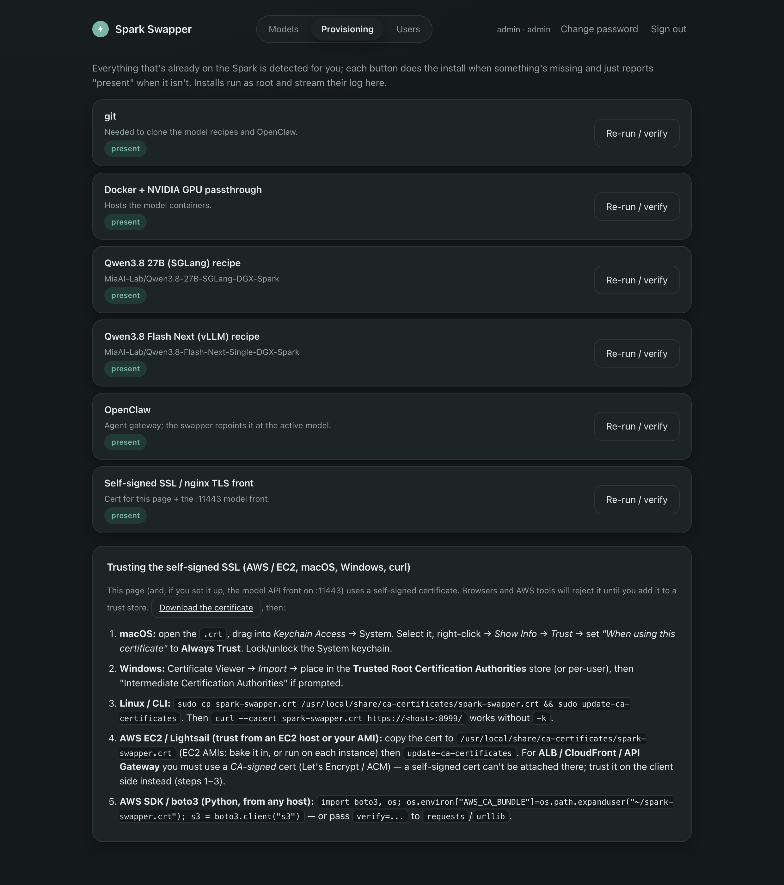
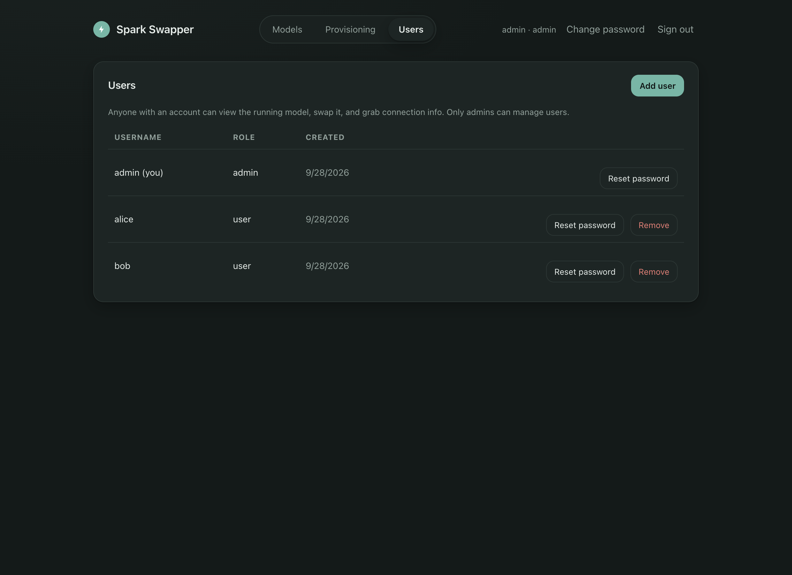
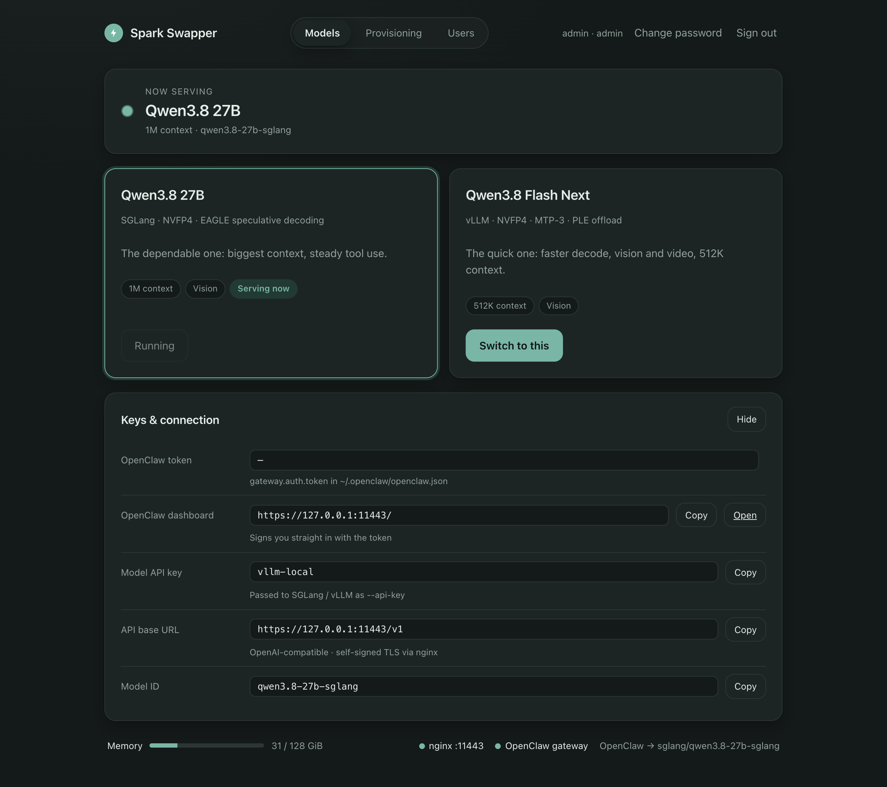

# Spark Swapper

A calm, multi-user web control panel for local LLM boxes — the **NVIDIA DGX Spark**
and the **AMD Strix Halo** (Ryzen AI Max+ 395, 128 GB). Switch between the models it
serves with one click, install new ones with their published speed and context in
front of you, connect Vision and your coding tools, and let it keep itself up to date —
all over HTTPS with a self-signed certificate.

Built with Python (standard library only) + a small vanilla-JS frontend. No pip,
no npm on the host.







---

## What it does

**Models tab**

- Shows which model is serving right now (or that the box is idle/loading), with a
  live memory meter and health dots for the HTTPS front and the OpenClaw gateway.
- Every model the box can run, with its **context window and speed**: the speed its
  recipe publishes (one request, and the total across several at once), and the speed
  Spark Swapper **measured on this box** the last time it loaded the model.
- **Install** on a model that isn't on the box yet: clones its recipe, builds or pulls
  its image, downloads its weights (resumable, checksum-verified) — and streams the log.
- **Switch to this**: stops the running model, waits for memory to free up, starts the
  other one, checks it answers (and times it), and repoints OpenClaw at it
  (`agents.defaults.model.primary`, image, compaction and memory-flush models, via
  `openclaw config patch`, then restarts the gateway). If the new model fails to load,
  the previous one is brought back automatically.

**Connect tab** — everything another app needs: the OpenAI-compatible base URL, API
key and current model ID (with a **Test** button), **connection codes for Vision**,
ready-to-paste setup for curl, Python, JavaScript, Continue, Cline / Roo / Kilo, Aider,
OpenCode, Qwen Code, Claude Code (with a model that speaks the Anthropic API) and
OpenClaw, and how to trust the certificate on macOS, Windows, Linux, Node, Python and AWS.

**Provisioning tab** — detects what's present and installs what's not. It adapts to the
hardware:

| | DGX Spark | Strix Halo |
|---|---|---|
| git | ✓ | ✓ |
| Docker + NVIDIA GPU passthrough | ✓ | |
| AMD GPU drivers (Mesa RADV, Vulkan) | | ✓ |
| llama.cpp — Unsloth's Vulkan build with MTP drafts, checksum-verified | | ✓ |
| GPU memory limit (`ttm.pages_limit`, ~108 GiB; needs a reboot) | | ✓ |
| OpenClaw (Node.js + the `openclaw` npm package) | ✓ | ✓ |
| HTTPS front: nginx on `:11443`, **requires the API key** | ✓ | ✓ |

**Users tab** (admin) — add users, reset passwords, remove accounts.

**Settings tab** (admin) — updates (see below) and what this box is.

---

## Models

Speeds are tokens per second for one request (decode), from each recipe's own
benchmarks; "across 8" is the total with eight requests at once. Spark Swapper also
measures every model on your box when it loads it, and shows that next to these.

### DGX Spark (NVIDIA GB10, 128 GB)

| Model | Recipe | Context | Speed |
|---|---|---:|---|
| **Qwen3.8 27B** (TensorFold, DFlash2) | [MiaAI-Lab/Qwen3.8-27B-DGX-Spark-TensorFold](https://github.com/MiaAI-Lab/Qwen3.8-27B-DGX-Spark-TensorFold) | 262,144 | 58.3 prose · 136.9 code · 220.6 across 8 |
| **Qwen3.8 Flash Next** (TensorFold, MTP) | [MiaAI-Lab/Qwen3.8-Flash-Next-Single-DGX-Spark-TensorFold](https://github.com/MiaAI-Lab/Qwen3.8-Flash-Next-Single-DGX-Spark-TensorFold) | 262,144 | 64.4 prose · 200.9 across 8 |
| **Nemotron 3.5 Lightning** 30B-A3B (SGLang, DSpark) | [MiaAI-Lab/Nemotron3.5-Lightning-DGX-Spark-RTX-5090-6000-PRO](https://github.com/MiaAI-Lab/Nemotron3.5-Lightning-DGX-Spark-RTX-5090-6000-PRO) | 1,048,576 | ≈124 · ≈355 across 8 (community measurement with vLLM; the recipe publishes none) |
| Qwen3.8 27B (SGLang, EAGLE) | [MiaAI-Lab/Qwen3.8-27B-SGLang-DGX-Spark](https://github.com/MiaAI-Lab/Qwen3.8-27B-SGLang-DGX-Spark) | 1,000,000 | 24.2 code · ~18 prose |
| Qwen3.8 Flash Next (vLLM) — *superseded by the TensorFold recipe* | [MiaAI-Lab/Qwen3.8-Flash-Next-Single-DGX-Spark](https://github.com/MiaAI-Lab/Qwen3.8-Flash-Next-Single-DGX-Spark) | 524,288 | 48.7 · 162.9 across 8 |

The TensorFold and Nemotron recipes run as the box's user (who is added to the
`docker` group), bound to `127.0.0.1`; other machines reach them through the HTTPS
front, which checks the API key — those servers have no key of their own.

### Strix Halo (AMD Ryzen AI Max+ 395, 128 GB)

llama.cpp's `llama-server` with the Vulkan backend, run as a systemd unit
(`swapper-llama-<model>`), with the models' own MTP heads for speculative decoding.

| Model | Weights | Context | Speed |
|---|---|---:|---|
| **Qwen3.8 27B** Q4_K_M | [lmstudio-community/Qwen3.8-27B-GGUF](https://huggingface.co/lmstudio-community/Qwen3.8-27B-GGUF) (16.8 GB) | 131,072 | 26.5 ([yandaq/qwen3.8-27b-strix-halo](https://github.com/yandaq/qwen3.8-27b-strix-halo)) |
| Qwen3.8 27B UD-Q8_K_XL | [unsloth/Qwen3.8-27B-GGUF](https://huggingface.co/unsloth/Qwen3.8-27B-GGUF) (31.5 GB) | 131,072 | 15.2 (same source) |
| Qwen3.8 Flash Next UD-Q3_K_XL + MTP head | [unsloth/Qwen3.8-Flash-Next-GGUF](https://huggingface.co/unsloth/Qwen3.8-Flash-Next-GGUF) (~93 GB) | 131,072 | not published — estimated 30–50; measured on your box after the first load |

Flash Next needs the GPU to map ~96 GiB: run **Provisioning ▸ GPU memory limit** once
and reboot. llama.cpp comes from [unslothai/llama.cpp](https://github.com/unslothai/llama.cpp)
releases because mainline llama.cpp has no MTP drafting for these models yet; every
build is checked against the SHA-256 the release publishes.

### Changing the API key

Set `"api_key"` in `/etc/spark-swapper/models.json` (letters, digits, `.`, `_`, `-`), then
`sudo systemctl restart spark-swapper`, run *Provisioning ▸ HTTPS front* again, and switch
models once (the SGLang container is recreated with the new key automatically). Connected
apps need the new key — Vision users paste a new connection code.

Other switches in that file: `"allow_open_front": true` lets key-less models start behind a
front that doesn't check the key (not recommended); `"llamacpp_sandbox": false` runs
llama-server as root if its sandbox can't reach the GPU on your system.

### Adding or changing models

Models live in `swapper/catalog.json`, which ships with every release — so an update
brings new models to boxes installed long ago. To change one on a single box, add an
entry with the same key under `"models"` in `/etc/spark-swapper/models.json`: its
fields are merged over the catalog's (yours win). `"hidden_models"` hides catalog
models; `"platform"` forces `nvidia-gb10` or `amd-strix-halo` instead of detecting it.

---

## Install (one click)

On the Spark or Strix Halo box (Ubuntu / DGX OS, Python 3.10+):

```bash
curl -fsSL https://raw.githubusercontent.com/gnubyte/DGX-Spark-Swapper/main/install-swapper.sh | bash
```

That script installs git if missing, clones this repo, and runs the host installer
(`deploy/install.sh`), which:

- copies the app to `/opt/spark-swapper`,
- renders `swapper/models.json` (the site template with `{{USER}}` / `{{PUBLIC_HOST}}`
  / `{{OPENCLAW_BIN}}` placeholders) into `/etc/spark-swapper/models.json` using real
  values (existing config wins),
- generates a 10-year self-signed cert in `/etc/spark-swapper` if none exists,
- installs and starts `spark-swapper.service` (runs as root — docker, systemd and the
  model recipes need it) and opens `8999/tcp` in ufw if active.

Then open **https://\<box-ip\>:8999** and create the admin login (one-time). On the
Provisioning tab, install what's missing (on a Strix Halo: the AMD drivers, llama.cpp
and the GPU memory limit), then install a model on the Models tab.

---

## Updates

Spark Swapper keeps itself current. Every **Sunday** (at a minute after 03:00 local
time picked once per box) it asks GitHub for the latest release, and when there's a
newer one it **installs it automatically** — unless you opt out.

- **Opt out:** Settings tab ▸ untick *Install new versions automatically* (it then only
  tells you an update is available), or untick the weekly check altogether. At install
  time: `sudo SWAPPER_AUTO_UPDATE=0 bash deploy/install.sh`.
- **On demand:** Settings ▸ *Check now* / *Update now*.
- **How it's safe:** the release package is checked against the release's `SHA256SUMS`
  and compile-checked before anything changes; `deploy/update.sh` from the new release
  runs outside the service (via `systemd-run`), copies `/opt/spark-swapper` aside,
  installs, waits for the page to answer, and **puts the old version back** if it
  doesn't. Your config, logins, connections and certificate are kept. Models keep
  serving — only the web page restarts. The result shows on the Settings tab.
- A Swapper running in Docker can't replace itself: it shows that an update is out;
  pull the new image (`pull-docker.sh`).
- **Signed releases (recommended):** the checksum only proves the download wasn't
  damaged — it comes from the same GitHub release as the package. To make boxes install
  only releases you signed, create a key once and ship its public half:
  ```bash
  ssh-keygen -t ed25519 -f ~/.ssh/spark-swapper-release -C "Spark Swapper releases"
  printf 'spark-swapper-release namespaces="spark-swapper-release" %s\n' \
    "$(cut -d' ' -f1,2 ~/.ssh/spark-swapper-release.pub)" > swapper/release-signers
  ```
  Commit `swapper/release-signers`; from the release after that, boxes refuse any update
  without a valid `spark-swapper-<version>.tar.gz.sig`. Sign each release with
  `deploy/sign-release.sh <version> ~/.ssh/spark-swapper-release` (the key never touches
  GitHub), or store the private key in the repo secret `RELEASE_SIGNING_KEY` to have the
  release workflow sign — automatic, but it then trusts anyone who can push to `main`.

**Publishing a release** (maintainers): bump `swapper/VERSION` and add a `## <version>`
section to `CHANGELOG.md`, then merge to `main`. `.github/workflows/release.yml` runs the
tests, builds `spark-swapper-<version>.tar.gz` (`git archive`) plus `SHA256SUMS`, and
publishes release `v<version>` with that changelog section as its notes.

To update by hand: `git -C ~/spark-swapper pull && sudo bash ~/spark-swapper/deploy/install.sh`.

---

## Connecting apps

**Vision (Mac and Windows):** Connect tab ▸ *Connect Vision* ▸ **Create connection code**, then
paste it into Vision's setup wizard (*My Spark Swapper*). The code carries the API address
and key, the certificate's SHA-256 fingerprint (Vision pins it — no "untrusted
certificate" dance), and an **app token** that lets Vision show what's serving and switch
models without your password. Revoke a connection on the same tab at any time.
(Vision was previously called DSH; connections made under the old name keep working.)

The code is `SSC1:` + base64url (no padding) of JSON:

```json
{"v": 1, "name": "DGX Spark (spark-3f2a)", "hostname": "spark-3f2a", "platform": "nvidia-gb10",
 "version": "2.0.0", "swapper_url": "https://192.168.1.42:8999",
 "api_base": "https://192.168.1.42:11443/v1", "api_key": "…", "model": "Qwen3.8-27B",
 "context": 262144, "fingerprint": "3A:9F:…", "token": "sst_…", "user": "pat"}
```

App tokens go in `Authorization: Bearer sst_…` on any `/api/*` call a signed-in user can
make, except managing users, tokens, passwords and updates. Useful endpoints:
`GET /api/status` (models with `installed`, `perf`, `measured`, `context`),
`POST /api/swap {"target": key}`, `GET /api/connect`, `POST /api/models/install {"key": …}`.

**Anything OpenAI-compatible:** base URL `https://<box>:11443/v1`, the API key, and the
model ID — the Connect tab has copy-paste setups for common tools.

---

## Docker (pulled from GitHub Artifacts)

A container image is built on every push and stored as a GitHub Actions artifact.
To pull and run it:

```bash
export GH_TOKEN=github_pat_...   # fine-grained PAT with Actions read on this repo
bash pull-docker.sh             # finds the latest successful `docker` run, loads, and starts
```

`pull-docker.sh` downloads the artifact tarball, `docker load`s it as
`gnubyte/dgx-spark-swapper:latest`, and runs it on the host network with
`/var/run/docker.sock` and `/etc/spark-swapper` mounted (so it can drive the model
containers and keep its cert/state). You can also build it yourself:

```bash
docker build -t dgx-spark-swapper .
docker run -d --name spark-swapper --network host \
  -v /var/run/docker.sock:/var/run/docker.sock \
  -v /etc/spark-swapper:/config -v /var/lib/spark-swapper:/state \
  dgx-spark-swapper
```

The container version drives Docker-based models; the recipe-script, llama.cpp, nginx
and update features need the host install.

---

## Trusting the self-signed SSL (AWS / EC2, macOS, Windows, curl)

This page and the `:11443` model front use a self-signed certificate. Browsers and AWS
tooling reject it until you add it to a trust store. Download it from the UI
(**Connect** tab → *Download the certificate*, or `https://<host>:8999/cert.crt`) and
check its fingerprint against the one the Connect tab shows
(`openssl x509 -in spark-swapper.crt -noout -fingerprint -sha256`), then:

1. **macOS** — open the `.crt`, drag it into **Keychain Access → System**. Select it,
   right-click → *Get Info* → *Trust* → set **"When using this certificate"** to
   **Always Trust**.
2. **Windows** — double-click the `.crt` → *Install Certificate* → place it in the
   **Trusted Root Certification Authorities** store (per-machine, or per-user).
3. **Linux / CLI** —
   ```bash
   sudo cp spark-swapper.crt /usr/local/share/ca-certificates/spark-swapper.crt
   sudo update-ca-certificates
   curl --cacert spark-swapper.crt https://<host>:8999/   # no -k needed
   ```
4. **Node.js tools** keep their own list: `export NODE_EXTRA_CA_CERTS=~/spark-swapper.crt`.
5. **AWS EC2 / Lightsail** (trust from an EC2 host or your AMI) — copy the cert to
   `/usr/local/share/ca-certificates/spark-swapper.crt` (bake it into the AMI, or run
   on each instance), then `update-ca-certificates`. For **ALB / CloudFront / API
   Gateway** you must use a *CA-signed* cert (Let's Encrypt / ACM) — a self-signed
   cert can't be attached there; trust it on the client side instead (steps 1–3).
6. **AWS SDK / boto3** (Python, from any host) —
   ```python
   import boto3, os
   os.environ["AWS_CA_BUNDLE"] = os.path.expanduser("~/spark-swapper.crt")
   s3 = boto3.client("s3")   # or pass verify=... to requests/urllib
   ```

---

## Security

- Passwords are hashed with scrypt (PBKDF2 fallback on libressl builds).
- Sessions are HMAC-signed cookies (`HttpOnly; Secure; SameSite=Strict`, 30 days).
  Changing a password signs out that user's other browsers (per-user epoch).
- App tokens (`sst_<id>_<secret>`) are stored only as SHA-256 hashes (`tokens.json`,
  0600); they act as their user minus user/token/password/update management, and are
  revoked when the user is removed. `spark-swapper-reset-login` clears them too.
- Multi-user: first visitor creates the **admin** login; admins add others via the
  Users tab. Non-admins get 403 on admin routes.
- Every state change is a JSON POST that must carry an `X-Swapper` header and a
  matching `Origin`; five wrong passwords from one address locks it out on a
  doubling interval (30 s → 1 h).
- The model servers listen on `127.0.0.1` only; the HTTPS front on `:11443` written by
  Spark Swapper refuses requests without the API key (Bearer or `x-api-key`). A fresh
  install gets its own random key. Models whose servers have no key of their own
  (TensorFold 27B, Nemotron) won't start while `:11443` is served by a front that doesn't
  check the current key — run *Provisioning ▸ HTTPS front* first.
- llama.cpp servers (Strix Halo) run as a throwaway unprivileged user (`DynamicUser`)
  with a read-only system; the weights and builds live in `/var/lib/spark-swapper-runtime`.
- Recipe scripts run as the box's user (via `setpriv`), with secrets passed in the
  environment rather than on the command line.
- `sudo spark-swapper-front` sets up the HTTPS front from a shell (Vision's Spark guide uses it);
  an update replaces a front written by the Windows app's own Spark guide with one that
  checks the key.
- Downloads (weights, llama.cpp, updates) are verified against published SHA-256s
  before use; archives are unpacked with path checks.
- Strict CSP (no inline scripts), TLS 1.2+ only, `X-Frame-Options: DENY`.
- **The first visitor creates the admin login, so open the page yourself right
  after installing** — anyone else on the LAN could claim it.

---

## Configuration & layout

- `swapper/catalog.json` — the models: platforms, install steps, start/stop, speeds.
- `swapper/models.json` — the site template (ports, API key, OpenClaw paths, per-box
  overrides). Rendered once to `/etc/spark-swapper/models.json`.
- `swapper/VERSION` — this release's version.
- `swapper/app.py` — the HTTPS server, auth, app tokens and routing.
- `swapper/engine.py` — the swap engine (stop/start/verify/measure models, repoint
  OpenClaw, boot reconcile).
- `swapper/installer.py` — provisioning: presence detection, infrastructure installs,
  model installs.
- `swapper/updater.py` — the weekly update check and self-install.
- `swapper/hardware.py`, `config.py`, `fetch.py`, `tokens.py` — platform detection,
  config merging, verified downloads, app tokens.
- `swapper/web/` — the static frontend (index.html, app.js, app.css).
- `deploy/install.sh`, `deploy/update.sh`, `deploy/spark-swapper.service` — host
  install, self-update with rollback, systemd unit.
- `install-swapper.sh` — the one-click bootstrap (installs git, clones, runs install).
- `pull-docker.sh` — pull the container from GitHub Artifacts and run it.
- `tests/` — unit tests: `python3 -m unittest discover -s tests`.
- `.github/workflows/` — `test.yml` (tests), `release.yml` (releases on a VERSION
  bump), `docker.yml` (container artifact).

Local UI preview with sample data (no root needed):

```bash
SWAPPER_DEMO=1 SWAPPER_DEMO_HTTP=1 SWAPPER_BIND=127.0.0.1 SWAPPER_PORT=18999 \
  SWAPPER_CONF=/tmp/ss/conf SWAPPER_STATE=/tmp/ss/state python3 swapper/app.py
# http://127.0.0.1:18999 — sign in as admin / admin. SWAPPER_DEMO_PLATFORM=amd-strix-halo for the Strix Halo view.
```

## Logs

- Host: `journalctl -u spark-swapper -f`
- llama.cpp models (Strix Halo): `journalctl -u swapper-llama-<model> -f`
- Updates: `/var/lib/spark-swapper/update.log`
- Docker: `docker logs -f spark-swapper`
- Each recipe launch log is kept under the state dir (`/var/lib/spark-swapper/` or
  the `/state` volume).
